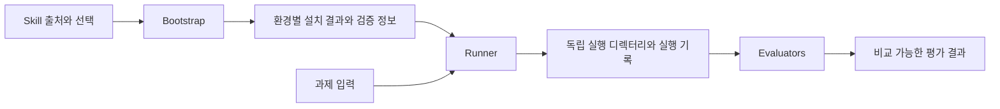

# 아키텍처 설계

이 문서는 [프로젝트 목적](./README.md)을 구현하기 위한 현재 구조와 제안 설계를 구분한다. Bootstrap의 상세 계약은 [Bootstrap 안내](./bootstrap/README.md)에 있다. 완료 조건은 [프로젝트 GOAL](./GOAL.md)과 [요구사항별 GOAL](./GOAL/README.md)에 있다. 실행 순서는 [로드맵](./ROADMAP.md)에서 관리한다.

피드백 시도와 품질·비용 측정의 확정 요구사항은 [REQ01](./docs/REQUIREMENTS/REQ01.md)이 소유한다.

## 현재 상태

- `package.json`에는 Bootstrap·과제·Runner·Promptfoo 비교·저장 결과 재평가 명령과 각 영역의 테스트, 기존 대화형 Codex 명령 세 개가 있다.
- `scripts/test-isolation.sh`는 필수 환경 또는 설치 인덱스에서 선택한 공개 환경을 저장소 밖의 임시 작업 경로에서 대화형 Codex로 시작한다. 과제, 반복 실행, 측정, 평가 기능은 없다.
- `bootstrap/`에는 출처 설정, 설치·검증 명령과 임시 저장소 통합 테스트가 있다. `tasks/`에는 수동 FE-01 REST Countries ZIP 과제와 공개 GitHub 과제 검색·등록 및 공통 frontend 기술 사양이 있다. `runner/`의 비대화형 실행과 JSONL 토큰 수집은 두 필수 환경의 짧은 직접 입력 과제와 종료된 FAQ 제한 과제의 최초 실행으로 확인했다. `evaluators/`에는 Promptfoo 비교와 FE-01 REST Countries 기능·접근성·기술 검사, 저장 결과의 TypeScript·ESLint·AI 코드 품질 재평가가 있다. `scripts/benchmark-runner.mjs`는 빈 파일이고 `fixtures/`에는 구현 파일이 없다.
- `environments/`에는 Bootstrap 설치 상태가 있다. 신규 작업 폴더와 결과는 저장소 밖에 두며 기존 `runs/`와 `results/`에는 역사적 기록을 보존한다. 현재 `baseline`, `codex-workspace`, `superpowers`의 Bootstrap 기록을 검증했다.

## 1단계 조사 결과

고정 커밋은 [`sources.json`](./bootstrap/sources.json)에 있다. GitHub의 해당 커밋 트리를 확인한 결과, 설치 대상 Skill은 다음 경로에 있다. 숫자는 해당 커밋에서 발견한 `SKILL.md` 수이며 실제 Codex 동작 검증 수가 아니다.

| 출처 | Skill 경로 | 정적 조사 결과 |
| --- | --- | --- |
| [`codex-workspace`](https://github.com/jo4086/codex-workspace) | `skills/<이름>/` | 고정 커밋의 `templates/global-AGENTS.md`를 전역 지침으로 복사하고, `hooks/hooks.json`, `hooks/git/`도 설치한다. |
| [`obra/superpowers`](https://github.com/obra/superpowers) | `skills/<이름>/` | Skill 15개. Codex 플러그인 선언도 있지만 Bootstrap은 Skill 파일만 복사한다. |
| [`anthropics/skills`](https://github.com/anthropics/skills) | `skills/<이름>/` | Skill 20개. 일부 내용은 Claude 중심이므로 실행 호환성은 별도 검증 대상이다. |
| [`mattpocock/skills`](https://github.com/mattpocock/skills) | `skills/<분류>/<이름>/` | Skill 39개. 설치 시 이름별로 평탄화한다. |

설치된 Codex CLI 0.167.0의 `codex exec --help`는 비대화형 실행, `--json`, 작업 경로 옵션을 제공한다. [OpenAI의 Skill 평가 예시](https://developers.openai.com/blog/eval-skills)는 `--json` 결과를 JSONL로 저장하고 `turn.completed`의 토큰 사용량을 읽는 방식을 설명한다. 두 필수 환경의 실제 소규모 실행에서 `turn.completed` 토큰 값을 확인했다. 이 실행의 JSONL에는 검증된 Skill 사용 이벤트가 없어 실제 활용 여부는 `unknown`이다.

## 책임과 데이터 흐름

| 소유 영역 | 책임 | 경계 |
| --- | --- | --- |
| `bootstrap/` | 필수 환경과 선택한 공개 모음별 환경 생성, 도구 확인, 설치, 커밋 기록, 검증, Runner용 환경 정보 준비 | 과제 실행과 Runner 소스 생성은 하지 않는다. |
| `environments/` | 환경별 HOME·CODEX_HOME·XDG_CONFIG_HOME과 설치된 구성 보관 | 설치 출력과 로컬 상태다. 원본 저장소나 실제 사용자 홈이 아니다. |
| `tasks/` | 과제별 원본·manifest·요구사항, 공개 과제 검색·등록, 공통 기술 사양과 초기 프로젝트 준비 | 정답·평가 자료와 원본 AI 지침을 Runner 입력에 넣지 않는다. |
| `fixtures/` | 현재 비어 있는 기존 디렉터리 | 신규 패키지 과제의 입력 저장소로 사용하지 않는다. |
| `runner/` | 과제·환경·반복 선택, 독립 작업 디렉터리 준비, 비대화형 Codex 실행, 시간·토큰·로그·종료 상태 수집 | Skill 설치와 평가 점수 산정은 하지 않는다. |
| `/tmp/skill-benchmark/<과제>-run-NN/` | 실행 번호 아래에 환경·반복별 작업 트리 배치 | 실행 직후 확인과 복원에 사용하는 임시 경로다. |
| `evaluators/` | Promptfoo 비교, FE-01 객관 검사, 저장 결과의 정적·AI 코드 품질 재평가, 등록 Skill과 실제 활용의 구분 | 구현 Codex 실행을 제어하지 않는다. 재평가에서는 격리된 결과물 복사본에 pnpm 설치·빌드·브라우저·정적 검사와 읽기 전용 AI 검사를 수행한다. |
| `~/.local/state/skill-benchmark/` | 과제별 번호, 실행·평가 기록, 사용자 체크리스트, 최종 복원 ZIP 보관 | Runner가 실행 단위를 만들고 Evaluators가 비교·품질 보고서를 기록한다. |
| `scripts/` | 개발·진단용 보조 명령 | 정식 Bootstrap·Runner 책임을 중복 구현하지 않는다. |

## 경계별 계약 제안

1. **출처 → Bootstrap:** `sources.json` 버전 1은 후보 식별자, 저장소 URL, 40자리 고정 커밋과 `skillsPath`를 제공한다. 필수 비교군은 선택 해제할 수 없고, 공개 모음은 복수 선택해 각각 별도 환경에 설치한다. 저장소별 Skill 디렉터리 구조는 조사했지만 실제 Codex 실행 호환성은 아직 검증하지 않았다.
2. **Bootstrap → Runner:** 현재 `environments/index.json`과 환경별 `environment.json` 버전 1에 식별자, 상대 HOME·CODEX_HOME·XDG_CONFIG_HOME 경로, 원본·커밋 또는 로컬 경로, Skill 목록·내용 해시·Codex 버전을 기록한다. Runner는 경로를 추측하거나 설치를 수행하지 않고 `verify`를 통과한 환경만 사용하도록 설계한다.
3. **Tasks → Runner:** Runner의 `--task`는 manifest에 따라 원본에서 허용된 초기 파일과 공통 frontend 틀을 준비한다. 과제 요구사항과 공통 기술 사양을 함께 전달한다. 모든 환경에 같은 준비 결과를 사용하며 실행마다 저장소 밖의 새 작업 디렉터리에 복사하고 합성 해시를 기록한다. 기존 직접 프롬프트·Fixture 옵션도 유지한다.
4. **Runner → Evaluators:** `run.json`에 실행 식별자, 환경·과제·반복·순서, 모델과 추론·실행 옵션, 시작·종료 시각, 종료 코드·타임아웃, 토큰 측정값 또는 측정 불가 상태, 로그와 시도별 산출물 스냅샷 위치·해시를 기록한다. 측정 불가를 0으로 기록하지 않는다. 두 개 이상 실행하면 모든 실행 기록을 비교기에 전달한다. `--evaluate-quality`를 명시한 호출은 모든 시도의 저장 결과를 추가 재평가한다.
5. **Evaluators → Results:** `compare`는 동일 과제·입력·실행 조건을 검증하고 Promptfoo에서 실행 성공 및 두 실행 모두 판정 가능한 FE-01 객관 항목을 비교한다. 시간·토큰은 원값과 환경별 집계로 남긴다. 별도 `evaluate`는 기능·접근성·빌드·TypeScript·ESLint와 Promptfoo `agent-rubric` 코드 품질을 검사하고 자동 품질 총점·합격, 분리된 구현·평가기 토큰을 기록한다. 시각 평가는 사용자가 별도로 수행한다. 등록 Skill은 설치 manifest에서 기록하며 실제 활용 증거가 없으면 `unknown`이다.

### Phase 3 과제 입력 구조

외부 과제의 원본, 과제별 프롬프트, 입력 선택 규칙, 평가 전용 자료를 `tasks/<과제 ID>/`에 함께 둔다. [과제 패키지 형식](./tasks/README.md)에 ZIP과 Git 원본의 규칙을 기록했다. 원본은 수정하지 않고 보관하며 실행 시 허용된 파일만 독립 작업 디렉터리에 준비한다. `AGENTS.md`·`CLAUDE.md` 및 원본의 AI 도구 안내, 정답 코드, 평가 자료는 실행 입력에 포함하지 않는다. 공통 기술 사양과 pnpm 기반 frontend 틀은 `tasks/shared/frontend/`에서 관리한다. pnpm 12가 `esbuild` 설치 스크립트를 차단해 준비 입력의 설치가 실패한 문제는 공통 템플릿의 `pnpm-workspace.yaml`에서 해당 패키지만 허용해 해결했다.

공개 저장소 공급원은 [`frontendwizards/frontend-challenges`](https://github.com/frontendwizards/frontend-challenges)다. 원본 CLI의 `start`는 `npm install`을 실행하고 `list`는 목록 출력이 미구현이므로 이 프로젝트는 직접 Git 커밋을 가져와 `problems/`의 요구사항·starter·solutions 구조를 분석한다. Source의 React 18·Tailwind v3 틀은 원본에 보존하고 실행용 틀은 React 19·TypeScript·Vite·Tailwind CSS v4·pnpm으로 별도 준비한다. 실제 공개 원격 검색과 Codex 세션의 동작은 검증 상태를 별도로 기록한다.

Runner와 Evaluators의 **버전 1 기록 계약**은 다음과 같다. 직접 입력 과제의 두 환경 실제 실행은 확인했으며 과거 FE-03로 기록된 REST Countries 결과는 원본 해시 검증 후 새 FE-01 기준으로 재평가한다.

| 파일 | 필수 정보 | 누락·변경 규칙 |
| --- | --- | --- |
| `attempts/<환경>/attempt-NN/run.json` | `schemaVersion`, 실행·과제·환경 ID, 반복 번호와 실행 순서, 입력 SHA-256, 과제 원본·manifest 해시, 모델·추론 수준·옵션, 시작·종료 시각, `completed`·`failed`·`timed_out` 상태, 종료 코드, 원시 JSONL 경로, 토큰 입력·출력 값, 시도별 `artifact` 경로·해시 | 토큰을 얻지 못하면 값은 `null`이고 누락 사유를 남긴다. 실행 중 실패도 기록을 남긴다. |
| `trials/<환경>/trial.json` | 독립 시도 ID, 같은 세션의 최대 3회 시도, 매 시도 객관 점수·점수 차이·입력/출력/캐시 토큰 증분·누적값·평가 피드백, 최초 시도 및 첫 진단 기준 도달 시도 | FE-01의 낮은 진단 기준 도달은 `diagnostic_target_reached`이며 전체 품질 합격이 아니다. 토큰은 기록만 하고 수정 중단에는 사용하지 않는다. 과거 FE-02 실행의 제거된 사후 한도 설정은 [검증 기록](./docs/REVIEW/REQ01/Phase01.md)에 보존했다. |
| `comparisons/<단계>/comparison.json` 및 `promptfoo.json` | 실행 ID 목록, 평가기 버전, 실행 성공 판정, 시간·토큰 원값과 환경별 집계, FE-01 객관 항목·근거와 미평가 항목, 등록·실제 활용 Skill 구분, Promptfoo 원본 결과 | 입력 조건이 다르면 비교하지 않는다. 토큰 누락은 `null`과 사유로 남긴다. Skill 활용은 증거가 없으면 `unknown`이다. |
| `quality/evaluation.json` | 실행별 기능·접근성·TypeScript·ESLint·AI 코드 품질의 개별 점수와 근거, 가중 총점·합격, 고정 평가 설정·코드 해시, 구현 토큰과 평가기 토큰 | Runner의 품질 평가 옵션 또는 `evaluate` 명령으로 생성한다. 미평가 영역은 `null`, 평가 오류는 별도 상태로 둔다. 시각 유사도는 자동 점수 밖이다. |

`results/<과제>/run-NN/result.json`은 환경별 시도와 보고서의 상대 경로를 연결한다. `state.json`의 번호는 파일 잠금 아래에서 할당한다. ZIP은 각 독립 실행의 최종 작업 트리를 보존한다. 환경 지침은 ZIP의 `environment/`에 저장하고, 복원은 `project/`만 새 임시 폴더로 푼다. 자동 평가에는 시도별 필터링된 `artifact/`를 사용한다.

Bootstrap, Runner와 비교 기록은 `schemaVersion: 1`로 구현되어 있다. 이후 계약에 호환되지 않는 변경은 버전을 올리고 이전 버전을 조용히 해석하지 않는다. FE-01 객관 검사기는 별도 버전 1을 기록하며 주관 평가의 계약은 아직 정하지 않았다.

인증은 환경별로 준비한다. 사용자가 선택하면 Bootstrap이 현재 파일 기반 로그인 캐시를 각 환경에 별도 복사할 수 있다. Bootstrap 검증은 인증을 검사하지 않으며 Runner는 실제 실행 전에 해당 환경의 `auth.json` 존재를 확인한다. 두 필수 환경의 소규모 실행에서 인증과 `turn.completed` 토큰 이벤트를 확인했다. 루트 지침 오염은 저장소 밖 작업 경로와 그 상위 경로의 `AGENTS.md` 탐색 검사로 예방하고, 두 작업 디렉터리에 관리용 지침 파일이 없음을 확인했다. Codex가 실제로 읽은 지침 전체와 파일 시스템 격리는 확인되지 않았다. 활용 근거가 없으면 `unknown`을 기록한다.

## 환경 격리와 안전

- 평가 대상 Codex의 작업 디렉터리는 저장소 밖 운영체제 임시 경로에 실행마다 새로 만들고 실행 후 결과 확인을 위해 남긴다. 루트 `AGENTS.md`가 지침 탐색 경로에 들어오지 않는지 실행 전 검증한다. 경로 분리만으로 완전한 파일 시스템 격리를 주장하지 않는다.
- 환경마다 HOME, CODEX_HOME, XDG_CONFIG_HOME을 분리한다. Baseline은 Codex 기본 제공 및 공통 플러그인 Skill만 유지하고 사용자 제작 지침·Hook·Skill을 추가하지 않는다.
- codex-workspace는 `codex-workspace`의 고정 Git 커밋을 기본으로 하고 로컬 개발본 복사는 선택지로 둔다. 공개 모음마다 별도 환경을 사용한다. 설치된 버전과 변경 여부를 검증한다.
- 파일 기반 인증은 사용자가 선택하거나 명시한 경우에만 사용자 Codex 홈에서 환경별로 복사한다. 원본과 기존 인증 파일을 덮어쓰지 않고, 내용과 해시를 기록에 남기지 않는다. 기존 환경을 지우거나 덮어쓰기 전에 변경 사항을 확인하고, 설치 실패의 영향 범위를 해당 환경으로 제한한다.
- 실행 조건을 가능한 한 같게 유지하고, 반복 횟수와 실행 순서를 기록한다. Skill 등록 여부와 실제 활용 여부를 독립적으로 판정한다.

## 남은 결정과 검증

- 공개 후보의 실제 Codex 실행 호환성, 공식 플러그인 기능과 Skill 전용 복사의 차이, 설치 대상 구성요소의 범위.
- 시각 유사도의 결과 스키마·근거 형식. 자동 코드 품질 재평가 스키마는 버전 1이며 실제 AI 호출의 기록은 아직 검증 전이다.
- 파일 기반 인증을 복사하지 않거나 키링을 사용하는 상태에서 비대화형 실행을 시작하는 사전 조건과 사용자 안내 방식.
- 실제 Codex JSONL의 Skill 사용 증거와 누락 시 판정 방식. `turn.completed` 토큰 값은 두 필수 환경의 제한 실행에서 확인했다.
- 공통 플러그인 Skill의 범위, 평가 대상의 지침 로딩 검증 방법, 공개 결과에서 로그와 민감 정보 제거 방식.
